<div align="center">

# Kairon

[](https://github.com/zyvorai/zyvor-kairon/actions/workflows/ci.yml)
[](https://github.com/zyvorai/zyvor-kairon/actions/workflows/mcp.yml)
[](https://github.com/zyvorai/zyvor-kairon/releases/latest)
[](https://goreportcard.com/report/github.com/zyvorai/kairon)
[](https://scorecard.dev/viewer/?uri=github.com/zyvorai/kairon)
[](https://www.bestpractices.dev/projects/15141)
[](LICENSE)
[](docs/DEPENDENCIES.md)

[](https://zyvor.dev/schedule?utm_source=github&utm_medium=kairon&utm_campaign=readme_hero)
[](https://zyvor.dev/poc?utm_source=github&utm_medium=kairon&utm_campaign=readme_hero)
[](#quickstart)


### VMs that don't pretend to be Pods.

**Real virtual machines, scheduled by Kubernetes, run straight on KVM.** No `virt-launcher` pod per VM, no libvirt in the hot path, no operator zoo. A `Machine` is desired state, `kairon-controller` places it, and `kairon-node` runs it on [FluxVM](https://github.com/zyvorai/zyvor-fluxvm) with QEMU, Cloud Hypervisor, Firecracker or FluxVM's own hypervisor.

**Zero pods per VM** · **Four hypervisors, one CRD** · **eBPF on every VM edge** · **No silent split-brain** · **AI agents built in (MCP)**

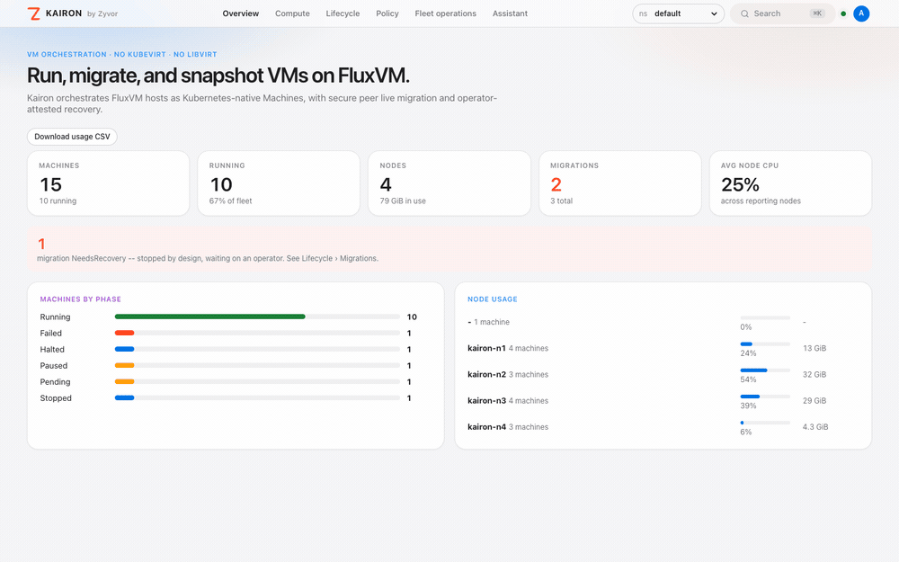

<sub>Dashboard tour captured against the local sample-data stack (<a href="docs/ux/README.md">how</a>), not a production cluster.</sub>


</div>

---

## What's new

New since v0.6.0 (latest tag: v0.10.0; the rows down to incident bundles are new in v0.10.0):

| | |
|---|---|
| **Agent sessions (experimental)** | An `AgentSession` is a FluxVM agent session: a sandbox VM with a git workspace, a compiled egress/filesystem/process policy, budgets, checkpoints, live forks and an event ledger, scheduled and quota-counted like a Machine. Commands can wait for an admin's approval; chunked uploads, an interactive shell, credential grants the guest never sees, and the Mac guest's screen. `kaironctl session`, `session_*` MCP tools, both SDKs and a dashboard page. Mac nodes on FluxVM 0.4.8+. [Guide →](docs/guides/agent-sessions.md) |
| **Coming from virtctl** | `kaironctl` covers virtctl's verbs: console and VNC (with screenshots), restart/soft-reboot, exports and memory dumps, guest info, SSH keys and passwords, `expose`, `freeze`, `guestfs`, `cdrom`, `create clone`, `objectgraph`, `--dry-run -o yaml`, `wait`. [CLI →](docs/CLI.md) |
| **Self-test: is it all working?** | `kaironctl selftest` (or the dashboard's Self-test page) boots a tiny CirrOS VM and proves power, network, hotplug, snapshot-restore and more, with live coloured logs and a PASS / FAIL / SKIP table. `deploy-remote.sh --self-test` runs it right after a deploy. [Guide →](docs/guides/selftest.md) |
| **Deploy without building locally** | `deploy-remote.sh --remote-build` copies a small source tarball and compiles on the host, so a laptop needs no Go, no Node and no build cache. [Fastest path →](docs/getting-started.md#fastest-path) |
| **HTTPS by default** | The dashboard and the VNC console relay serve TLS out of the box (generated or bring-your-own certificate); plain HTTP is a named opt-out. [Dashboard guide →](docs/guides/kairon-ui-dashboard.md#https) |
| **Mac Fabric (experimental)** | Several Macs as one pool: each publishes its chip, macOS, Rosetta, nested virtualization and Thunderbolt Bridge; `spec.apple` places vz Machines by them, and a `MacNetwork` gives Machines on different Macs one private network over Thunderbolt. Run against simulated Macs so far. [Guide →](docs/guides/mac-fabric.md) |
| **Cross-cluster DR (experimental)** | A `MachineProtectionPlan` replicates a group of Machines to S3 and keeps their specs and restore points on a second cluster, with RPO and RTO objectives. `kaironctl dr failover` brings them up there in dependency order, `--planned` with nothing lost; `kaironctl dr test` restores copies into an isolated network while production runs, also on a schedule. Machines keep their VirtualNetwork addresses and DNS names follow the active site through external-dns. [Guide →](docs/guides/cross-cluster-dr.md) |
| **vGPU profiles and GPU health (experimental)** | `spec.devices[].profile` gives a Machine a slice of a GPU (NVIDIA vGPU or MIG-backed profile) instead of a whole one, scheduled by free instances and GPU memory, created when the Machine starts and returned when it stops; unhealthy GPUs are skipped. [Guide →](docs/guides/gpu-vgpu.md) |
| **Accelerator profiles (experimental)** | A cluster-scoped `MachineAcceleratorProfile` names an accelerator shape (count, vendor or vGPU profile, memory per device, one PCIe root for peer to peer, one NUMA node, an RDMA NIC next to the GPUs); Machines ask for it with `spec.accelerators`. The profile's status says how many more Machines fit on each node. [Guide →](docs/guides/accelerator-profiles.md) |
| **Node maintenance and DRS (experimental)** | `kaironctl node maintenance enter NODE` cordons a node, migrates its Machines away, and stops or hibernates the ones with nowhere to go; exit puts everything back. DRS (`-drs-mode recommend|automatic`) evens out reserved CPU and memory across nodes, or moves Machines off nodes whose measured CPU, memory or IO pressure (PSI) is high, and `kaironctl drs plan` previews it. [Guide →](docs/guides/node-maintenance-drs.md) |
| **Per-disk I/O QoS** | IOPS and bandwidth limits on a Machine's root and data disks (`io.throttle`), with bursts, enforced by QEMU and changed live on a running Machine. [Guide →](docs/guides/disk-qos.md) |
| **NVMe-oF storage (experimental)** | Kairon's CSI driver provisions `nvme-tcp` and `nvme-rdma` volumes through the kernel NVMe target with native multipath; raw Block volumes boot Machines in place and attach as data disks with per-disk QEMU I/O. [Guide →](docs/guides/machine-storage-nvmeof.md) |
| **Hibernate (experimental)** | `spec.powerState: Hibernated` saves RAM and device state to disk and frees the node; resume continues the same boot, on its own node or a compatible one with shared storage. [Guide →](docs/guides/machine-hibernate.md) |
| **Virtual networks (experimental)** | `VirtualNetwork`: isolated IPv4 networks routed in eBPF with a Geneve overlay, per-network gateway, egress SNAT and floating IPs. [Guide →](docs/guides/virtual-networks.md) |
| **Elastic memory (experimental)** | Run more Machine memory than the node has: guaranteed minimums, a virtio-balloon reclaim loop and a `KaironMemoryPressure` signal the scheduler respects. [Guide →](docs/guides/machine-elastic-memory.md) |
| **Topology-aware placement (experimental)** | NUMA, GPU, NIC and NVMe locality: the scheduler picks the node, exact CPUs, NUMA memory and PCI devices together. [Guide →](docs/guides/machine-topology.md) |
| **Incident bundles (experimental)** | `kaironctl diagnose machine --deep`: one redacted tar.gz with the Machine's cluster state plus QMP, cgroup, console, dataplane and pcap from its node, and an opt-in guest memory dump. [Guide →](docs/guides/machine-incident-bundle.md) |
| **Lifecycle, diagnostics and namespaces (v0.9)** | `kaironctl doctor`, `connectivity test`, `logs`, `events`, `sysdump`, `config`, `history`/`rollback`; `kaironctl upgrade` keeps your previous Helm values. The dashboard has a namespace selector, an all-namespaces Machines view and bulk Start/Stop. [Release notes →](RELEASE_NOTES.md) |
| **`v1` API and new dashboard** | `kairon.zyvor.dev/v1` is the storage version (`v1beta1`/`v1alpha1` served, deprecated). The dashboard is redesigned and gains Storage (Atlas), Pools & claims, Images and Backups pages; `kairon-ui` now listens on `:18082`. [Guide →](docs/guides/kairon-ui-dashboard.md) |
| **Native macOS node** | `kairon-node` registers an Apple silicon Mac as a Node and runs `backend: vz` Machines through FluxVM. Verified on an M4; multi-Mac clusters not yet. [Guide →](docs/macos.md) · [Mac cluster →](docs/macos-cluster.md) |
| **Developer ecosystem kit** | Python and TypeScript SDKs, digest-pinned recipes, disposable-VM GitHub Actions, Terraform composition. [Kit →](ecosystem/README.md) |
| **Fleet automation (experimental)** | Opt-in Redfish fencing, balancing, autoscaling, backup and recovery plans, template claims, usage CSV and a Fleet dashboard. [Guide →](docs/guides/enterprise-fleet.md) |
| **Kairon vs KubeVirt benchmark** | Same node, same guest, one script driving both; method and raw JSON in [docs/benchmarks](docs/benchmarks/kairon-vs-kubevirt.md). |
| **Import from VMware** | `kaironctl import ova` streams an OVA once, reads vCPU, memory and firmware from the OVF, and FluxVM converts and repairs the disk. [Guide →](docs/guides/migrate-from-vmware.md) |
| **Warm pools and claims** | `MachinePool` keeps booted Machines ready; a `MachineClaim` binds one in a single reconcile tick, with per-claim egress allowlists. [Guide →](docs/guides/machine-pools.md) |
| **VM fork** | `kaironctl fork` and the MCP `fork_machine` tool fork a running Machine through FluxVM. [Guide →](docs/guides/machine-fork.md) |
| **Agent sandboxes (experimental)** | `spec.lifecycle` pauses idle Machines and wakes them on connect, deletes them after a max lifetime; paused warm pools, per-claim usage, and `Sandbox` classes in both SDKs. [Guide →](docs/guides/agent-sandboxes.md) |
| **Backups** | `MachineBackup` and `MachineBackupRestore` with guest filesystem freeze, plus Atlas S3 backup jobs for Atlas volumes. Incremental S3 backups with policies and GFS retention (experimental). [Guide →](docs/guides/machine-backup.md) |
| **Live disks and NICs** | Hot-attach PVC disks and hot-add or remove extra NICs on running Machines (`kaironctl disk`, `kaironctl nic`). [Guide →](docs/guides/machine-hotplug.md) |
| **Tenant fence** | `kairon.zyvor.dev/tenant-fence` turns `spec.tenant` into an east-west deny of other tenants' guest addresses in the namespace. [Guide →](docs/guides/tenant-fence.md) |
| **Preemption by Halt** | An opted-in high-priority Machine that can't be placed halts an opted-in lower-priority one, and it resumes when the preemptor leaves. [Guide →](docs/guides/preemption.md) |
| **Hotplug survives restart** | A stop/start boots at the hotplugged CPU and memory; `hotplug-persist` writes it back into spec. [Guide →](docs/guides/machine-hotplug.md#stopstart-keeps-the-realized-size) |
| **Halted resume keeps hotplug** | Resuming a Halted Machine hotplugs its CPU and memory back to the pre-halt size. [Guide →](docs/guides/machine-hotplug.md) |
| **Claims carry the template** | A `createMachine` pool claim gets the template's resources, kernel, cloud-init, NUMA, security, guest agents, TTL and forwards; anything not carried is listed in `machineWarnings`. [Guide →](docs/guides/machine-sandboxes.md#warm-pools) |
| **Daily snapshot schedules** | `dailyAt: "02:30"`, stable jitter and `maxAgeSeconds` retention on `MachineSnapshotSchedule`. [Guide →](docs/guides/machine-snapshot-schedules.md) |
| **CPU-pinning discovery, deployed** | `deploy-remote.sh --reserved-cpus=0-1` or Helm `node.cpuPinning` gives kairon-node kubelet's CPU state, so `pinnable-cpus` is discovered. [Guide →](docs/guides/machine-cpu-pinning.md) |
| **Approval for agent actions** | Destructive MCP tools wait for a single-use `kaironctl approve`. [Guide →](docs/guides/hermes-mcp.md) |
| **Stale evacuation** | Opt-in: Machines marked `evacuate=true` are fenced off a node attested dead with `kaironctl node fence`. [Guide →](docs/guides/machine-fencing.md) |
| **Image catalog and ISO installs** | Cluster-scoped `MachineImage` (disk or ISO, pinned by digest), `spec.cdroms` install media on SATA, blank root disks, and seeding of empty boot volumes. No CDI. [Guide →](docs/guides/machine-images.md) |
| **OCI containerDisk** | `spec.image.source.oci` pulls a disk image by digest with streaming per-layer verification. [Guide →](docs/guides/machine-image-import.md) |

---

## Why Kairon

| When this happens… | Kairon gives you… |
|---|---|
| Every VM drags a `virt-launcher` pod, libvirt and a QEMU wrapper behind it | **Nothing per VM but the VM.** `kairon-node` talks to FluxVM's REST API, which talks to KVM. |
| A migration dies halfway and nobody knows which copy is real | **`NeedsRecovery`.** An ambiguous commit stops the line and asks a human; it never guesses and never runs two copies. |
| You need microVMs for CI and agents, but full VMs for databases | **One `Machine` CRD, four hypervisors**: QEMU, Cloud Hypervisor, Firecracker, FluxVM. Pick per Machine with `spec.backend`. |
| VM networking means Pod CNI tricks, masquerade and Multus | **An eBPF edge on every VM tap**: anti-spoofing, DNS and TLS-SNI policy, rate limits, flows, attributed drops and packet capture. |
| Debugging the control plane means reading a client-go codebase | **Stdlib-only controller and node** ([dependency policy](docs/DEPENDENCIES.md)). Small enough to read in an afternoon. |
| Your AI agent needs to see and drive your fleet | **`kaironctl mcp serve`**: Machines, policies and live network data for Hermes Agent and any MCP client, writes gated behind `--allow-write`. |


---

## The numbers


| | **Kairon** | **KubeVirt v1.9.0** | |
|---|---|---|---|
| Idle control plane memory | **63 MiB** | 905 MiB | 14x less |
| 1 VM to SSH | **23.7 s** | 67.6 s | 2.9x faster |
| 5 VMs to SSH, median | **24.8 s** | 184.7 s | 7.4x faster |
| Memory per VM (5 VMs) | 660 MiB | 661 MiB | Even: same QEMU, same guest |

Same k3s node, same Ubuntu 24.04 image, same 1 vCPU / 512 MiB guest and cloud-init seed, one script driving both, ready meaning the guest's sshd answers. The VM costs the same either way; what you stop paying for is everything KubeVirt puts around it. Method, raw JSON and caveats (including the 10-VM run): [docs/benchmarks](docs/benchmarks/kairon-vs-kubevirt.md).

---

## Kairon vs KubeVirt


Every layer you remove is one less thing to patch, one less log to read and one less process to crash at 2 a.m.

| | **Kairon** | **KubeVirt** |
|---|---|---|
| A VM is | A `Machine`: its own CRD, its own lifecycle | A Pod in disguise (`virt-launcher`) |
| Pods per running VM | **0** | 1 `virt-launcher` pod each |
| Idle control plane, 5 VMs to SSH ([measured](#the-numbers)) | **63 MiB**, **25 s** | 905 MiB, 185 s |
| Path to KVM | `kairon-node` → FluxVM REST → KVM | `virt-handler` → `virt-launcher` → libvirt → QEMU |
| Hypervisors | **QEMU, Cloud Hypervisor, Firecracker, FluxVM** | QEMU via libvirt |
| MicroVMs and warm pools | Firecracker / FluxVM sandboxes, FluxVM warm pools ([24 ms claim measured](https://github.com/zyvorai/zyvor-fluxvm/tree/main/docs/benchmarks)) | Not a target |
| Scheduling | Capacity-aware Kairon placement on real allocatable | Pod scheduler plus virt extras |
| Control plane code | **Go standard library only** (controller, node) | Large client-go / controller-runtime surface |
| VM network | **eBPF VM edge**: anti-spoof, DNS/SNI policy, rate limit, flows, drop reasons, pcap | Pod CNI, masquerade/bridge binding, Multus |
| Network policy | `MachineNetworkPolicy` + `NetworkSecurityGroup`, optional Cilium sync | Pod `NetworkPolicy` |
| Live migration | mTLS node-to-node prepare/commit/abort with an encrypted data plane | libvirt migration inside the virt stack |
| Ambiguous migration commit | **`NeedsRecovery`**: no silent split-brain | Stack-dependent recovery |
| Packet capture of one VM | `kaironctl network capture demo --seconds 15` | Exec into the launcher pod and bring your own tools |
| AI agents | **MCP server built in** (`kaironctl mcp serve`) | Not included |
| Browser console | noVNC relay with per-Machine allowlists and Kubernetes RBAC | `virtctl vnc` / external UI |
| Source of truth | **The Kubernetes API, nothing else** | Kubernetes plus virt abstractions |
| Install | One Helm chart from OCI, or `kaironctl install` | Operator plus CR, CDI for images |
| **Choose KubeVirt when** | | You need its years of ecosystem integrations (OpenShift Virtualization, Harvester) today |

The previous layer-stack illustration: [docs/assets/kairon-vs-kubevirt.jpg](docs/assets/kairon-vs-kubevirt.jpg).

---

## What you get

### Machines, not Pods

`Machine` and `MachineSet` with instance types, NUMA and CPU pinning, Windows guests, PVC and CSI boot, multi-volume virtiofs, CPU/memory hotplug, pause and halt, cloud-init and port forwards. Desired state lives in Kubernetes; the node reconciles it every few seconds. [What ships →](docs/WHAT_SHIPS.md)

```bash
kaironctl create demo --image /var/lib/fluxvm/images/ubuntu.qcow2 --cpu 2 --memory 2Gi --backend qemu
kaironctl get machines
```

### Migration that refuses to guess

Cold migration, node evacuation, and secure live migration over mutual TLS with an encrypted data plane. Cordon a node and the controller can evacuate it for you, throttled by `MachineDisruptionBudget`. When a commit is ambiguous the Machine goes to `NeedsRecovery` and waits for an operator instead of risking two running copies. [Relocating →](docs/guides/relocating-a-machine.md) · [NeedsRecovery runbook →](docs/runbook-migration-failures.md)

### An eBPF edge on every VM

Each VM tap gets FluxVM's eBPF dataplane: anti-spoofing, DNS and TLS-SNI allowlists, rate limits, and drops attributed to a reason (`spoof_ip`, `dns_deny`, `sni_deny`, `rate_limit`, …). Write policy as `MachineNetworkPolicy` / `NetworkSecurityGroup`; see it live in the CLI and the dashboard **Network** panel; capture packets from one VM in one command. [VM edge →](docs/ebpf-edge.md) · [Network fabric →](docs/network-fabric.md)

```bash
kaironctl network flows demo --limit 20
kaironctl network drops demo
kaironctl network capture demo --seconds 15 --output demo.pcap
```

### AI agents, safely


`kaironctl mcp serve` speaks the Model Context Protocol over stdio. Hermes Agent, Claude, Cursor or any MCP client can list Machines, read policies and pull flows, drops and captures. Power, snapshot, capture, sealed-claim and policy-apply tools only appear with `--allow-write`, and every write is recorded in a hash-chained audit log first. `kaironctl agent ask` turns a plain-English request into a validated proposal using any OpenAI-compatible model, and `kaironctl agent diagnose` ranks why a Machine or migration is stuck; neither applies anything, and no model runs in the reconcile loop. Covered end to end in CI with the official MCP SDK. [AI agents →](docs/ai-agents.md) · [Agent plane →](docs/guides/agent-plane.md)

### Snapshots and recovery

`MachineSnapshot`, `MachineSnapshotRestore` and `MachineSnapshotSchedule` on CSI VolumeSnapshots, with guest-agent filesystem freeze for application-consistent snapshots. VM memory snapshots through FluxVM, and CRD backup/restore scripts for disaster recovery. [Snapshots →](docs/guides/machine-snapshot-quiesce.md)

### Fleet guards and operations

`MachineQuota`, `MachineDisruptionBudget`, `MigrationPolicy` and an opt-in admission webhook. `kairon-ui` dashboard with SSO, per-operator accounts and an in-browser VNC console. Prometheus metrics and alerts, controller HA leases, opt-in OpenTelemetry spans. [Observability →](docs/guides/observability.md) · [Security →](SECURITY.md)

---

## The dashboard

<div align="center">
<picture>
  <source media="(prefers-color-scheme: dark)" srcset="docs/ux/night-01-machines.png">
  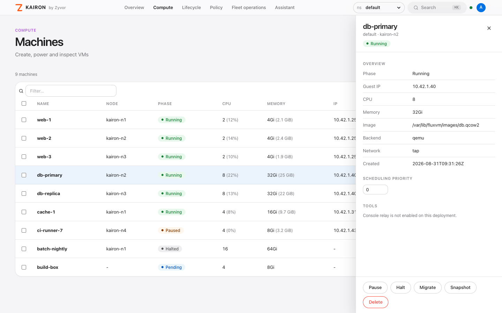
</picture>
</div>

<table>
<tr>
<td width="33%">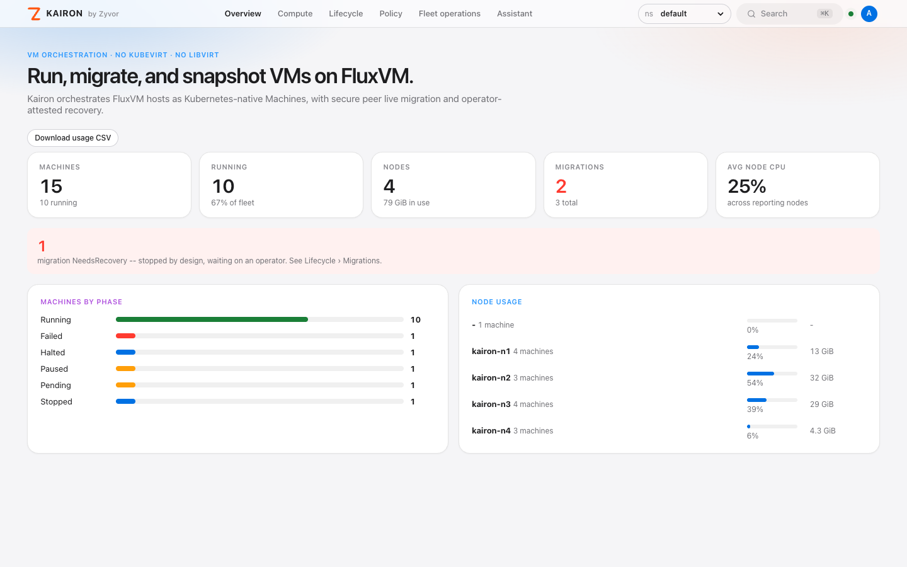<br><sub>Overview: fleet health and node usage</sub></td>
<td width="33%">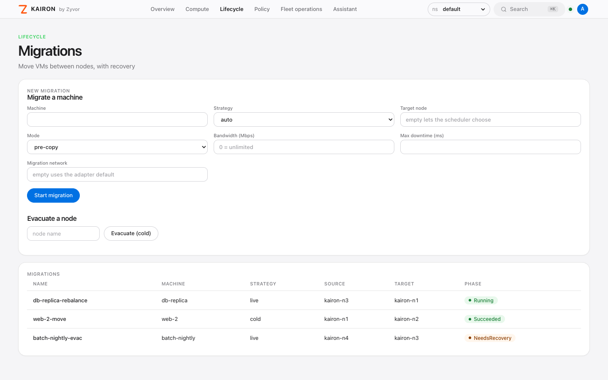<br><sub>Migrations, with NeedsRecovery surfaced</sub></td>
<td width="33%">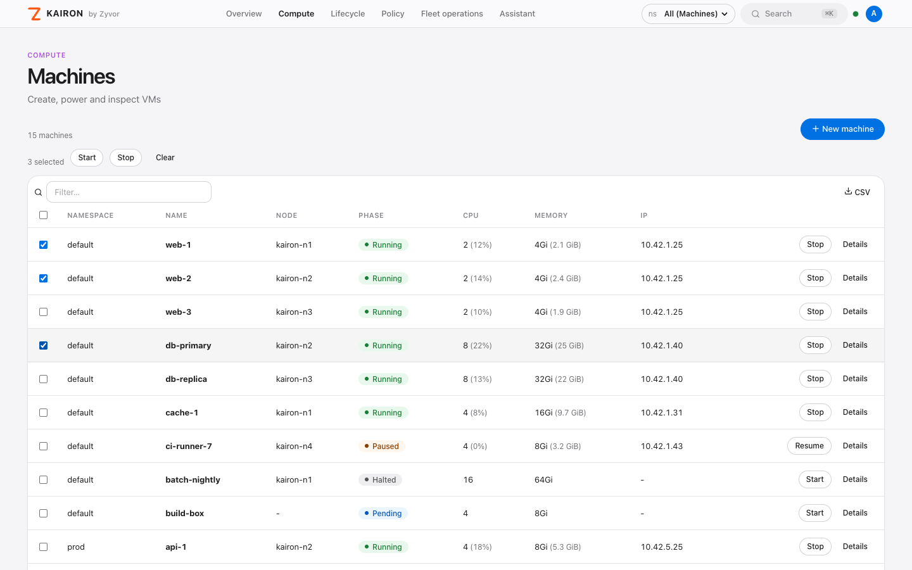<br><sub>All namespaces, bulk Start/Stop</sub></td>
</tr>
</table>

<p align="center">
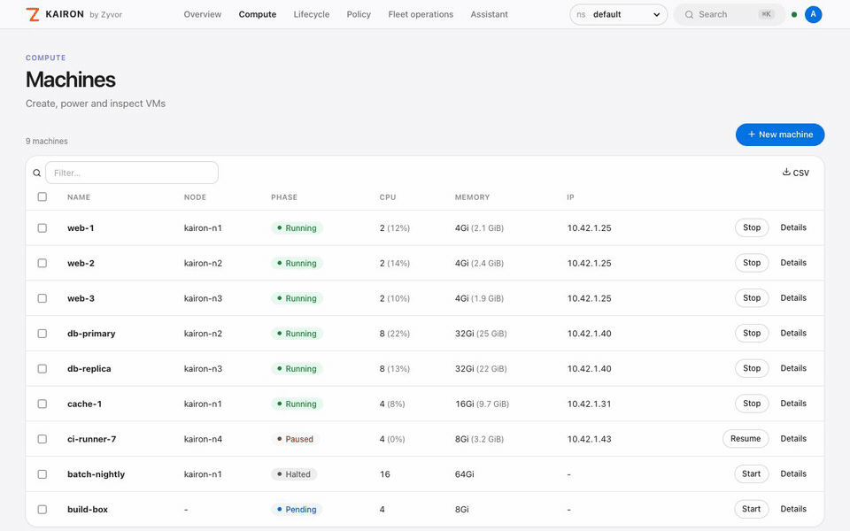

</p>

More pages: [gallery](https://zyvorai.github.io/zyvor-kairon/gallery). Screenshots and clips are generated from the sample-data stack in [`docs/ux`](docs/ux/README.md), so they show the real dashboard build, not a lab cluster.

---

## How it fits together

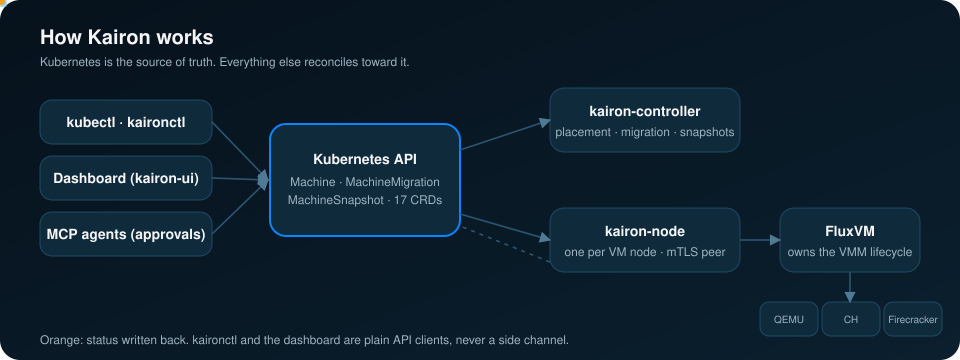

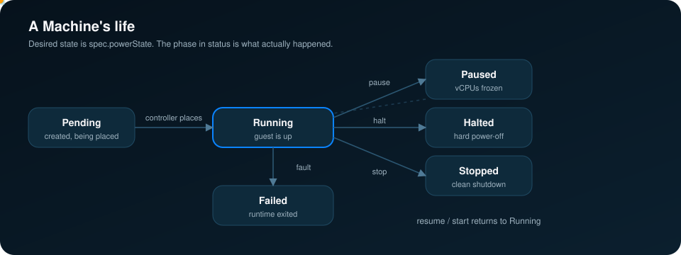



<details>
<summary><b>New in v0.10.0, animated:</b> agent sessions, idle sandboxes, cross-cluster DR, maintenance and DRS, elastic memory, incremental backups, Mac Fabric</summary>








</details>


| Component | Port | Role |
|---|---|---|
| `kairon-controller` | `:32301` health, `:8443` webhook | Placement, migration state machine, fencing, snapshots, quotas and budgets |
| `kairon-node` | `:32302` health, `:9443` mTLS peer, `:8090` console | Per-host agent: FluxVM lifecycle, eBPF policy, live-migration peer, edge Warning events, confidential-capability label |
| `kairon-ui` | `:18082` (HTTPS) | Optional dashboard: Machines, migrations, snapshots, Storage (Atlas), Pools & claims, Images, Backups, Network panel, VNC console; see [dashboard guide](docs/guides/kairon-ui-dashboard.md) |
| `kaironctl` | — | CLI and `kubectl kairon` plugin, embedded Helm installer, MCP server |
| FluxVM | `127.0.0.1:7788` | The VMM layer on each host: QEMU, Cloud Hypervisor, Firecracker, FluxVM |

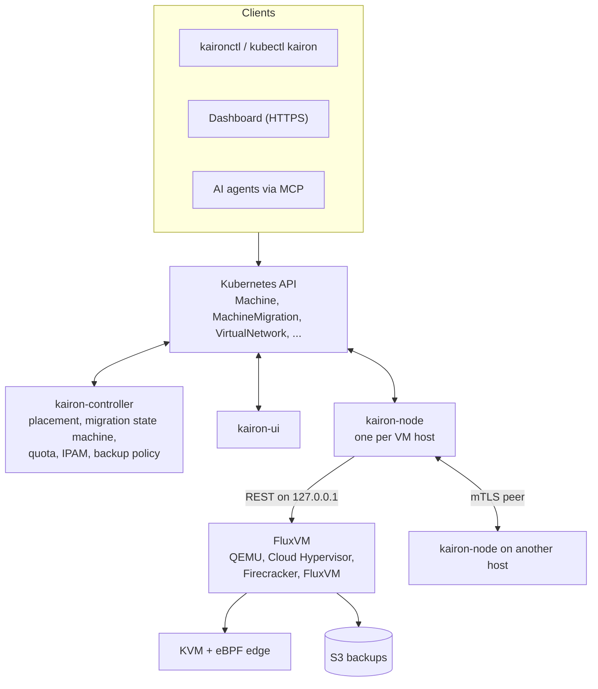

Full write-up: [ARCHITECTURE.md](ARCHITECTURE.md) · [docs/architecture.md](docs/architecture.md) · architecture illustration: [docs/assets/readme-architecture.jpg](docs/assets/readme-architecture.jpg)

---

## Quickstart

On a Kubernetes cluster whose VM hosts run [FluxVM](https://github.com/zyvorai/zyvor-fluxvm):

```bash
kubectl label node worker-1 kairon.zyvor.dev/capable=true

helm upgrade --install kairon oci://ghcr.io/zyvorai/charts/kairon \
  --version 0.10.0 -n kairon-system --create-namespace \
  -f https://raw.githubusercontent.com/zyvorai/kairon/v0.10.0/charts/kairon/values-production.yaml

curl -fsSL -o kaironctl https://github.com/zyvorai/kairon/releases/download/v0.10.0/kaironctl-linux-amd64
chmod +x kaironctl && sudo mv kaironctl /usr/local/bin/      # or: kubectl krew install kairon

kaironctl create demo --image /var/lib/fluxvm/images/ubuntu.qcow2 --cpu 2 --memory 2Gi
```

The production profile pins image tags to `Chart.AppVersion` and turns on the webhook, namespace isolation, network default-deny and migration data-plane TLS. Images: `ghcr.io/zyvorai/kairon-{controller,node,ui}`, signed with checksums and SBOM.

From your laptop to a bare-metal host, built on the host so your laptop needs no Go or Node, with a smoke test at the end:

```bash
./scripts/deploy-remote.sh user@host --remote-build --with-controller --with-ui --with-console --self-test=quick
```

Without `--remote-build` the binaries are cross-compiled locally and shipped as static files. Either way the dashboard and the console relay are HTTPS. [All flags and the deploy flow →](docs/getting-started.md#fastest-path)

Then, on any install: `kaironctl doctor` checks the control plane and `kaironctl selftest` boots a CirrOS VM to prove it end to end.

<details>
<summary><strong>From source, kind, or raw manifests</strong></summary>

```bash
git clone https://github.com/zyvorai/zyvor-kairon.git && cd zyvor-kairon
make docker-build
helm upgrade --install kairon ./charts/kairon -n kairon-system --create-namespace
# or: kaironctl install   (embedded Helm SDK, no helm binary needed)
```

Raw manifests: `kubectl apply -f deploy/crd.yaml -f deploy/rbac.yaml -f deploy/controller.yaml -f deploy/node.yaml`, plus `deploy/ui.yaml` for the dashboard and `deploy/rbac-cbt-backup.yaml` only if you enable [incremental S3 backups](docs/guides/machine-backup-incremental.md).

</details>

### Requirements

- A Kubernetes cluster whose VM hosts are Linux with `/dev/kvm`.
- FluxVM on each VM host (default `127.0.0.1:7788`).
- For the eBPF edge: a kernel with BTF and cgroup v2, and `dataplaneMode: ebpf`.

| Next step | Where |
|---|---|
| First Machine, end to end | [Getting started](docs/getting-started.md) |
| Everything that ships | [What ships](docs/WHAT_SHIPS.md) |
| Every command | [CLI reference](docs/CLI.md) |
| Hardware evidence | [Compatibility matrix](docs/COMPATIBILITY.md) |

---

## Operate

```bash
# Relocate
kaironctl migrate demo --strategy cold --target-node worker-2
kaironctl migrate demo --strategy live --target-node worker-2 --mode pre-copy
kaironctl evacuate worker-1 --wait

# See the network from the VM's point of view
kaironctl network status demo
kaironctl network drop-reasons demo
kaironctl network identity demo

# Hand the fleet to an AI agent
kaironctl mcp serve                  # add --allow-write for power, snapshot, capture and claims (audited)
kaironctl agent diagnose machine/demo   # ranked causes; adds a model summary when KAIRON_LLM_URL is set

# Dashboard (HTTPS; self-signed unless ui.tls.secretName is set)
kubectl -n kairon-system port-forward svc/kairon-ui 18082:18082   # then https://localhost:18082
kaironctl ui                         # or through the API server, no port-forward
```

---

## Maturity

| Area | Status |
|---|---|
| `Machine` lifecycle, MachineSet, instance types, quotas, budgets | Stable |
| Capacity-aware scheduling, node-scoped watches, controller HA | Stable |
| Cold migration and evacuation | Stable |
| Secure live migration and `NeedsRecovery` | Preview, multi-host lab matrix in progress ([COMPATIBILITY](docs/COMPATIBILITY.md)) |
| Adaptive live migration (auto-converge, post-copy switch, zstd) | Experimental, adaptive lab cases not yet run ([COMPATIBILITY](docs/COMPATIBILITY.md)) |
| eBPF VM edge, flows, drops, capture | Preview, single-host lab green |
| CSI snapshots with guest quiesce | Stable |
| `kairon-ui` with SSO and VNC console | Stable |
| MCP server for AI agents | Preview, CI end-to-end with the official SDK |
| CPU/memory hotplug | Grow-only (QEMU) |

**v0.10.0** is the latest release. Real two-host live migration is still Preview: the multi-host lab matrix is not yet green, so it is not claimed as Stable. Adaptive live migration stays Experimental until its four matrix cases pass on the nightly lab workflow, and it can't be called production-ready before the base live-migration rows are green too. Honest gaps live in [docs/STATUS.md](docs/STATUS.md); what comes next is in [ROADMAP.md](ROADMAP.md).

---

## Docs

| Goal | Document |
|---|---|
| Getting started | [docs/getting-started.md](docs/getting-started.md) |
| What ships | [docs/WHAT_SHIPS.md](docs/WHAT_SHIPS.md) |
| Architecture | [ARCHITECTURE.md](ARCHITECTURE.md) · [docs/architecture.md](docs/architecture.md) |
| Developer ecosystem | [SDKs, templates, CI and integrations](ecosystem/README.md) |
| AI agents and MCP | [docs/ai-agents.md](docs/ai-agents.md) |
| Status and gaps | [docs/STATUS.md](docs/STATUS.md) |
| Hardware matrix | [docs/COMPATIBILITY.md](docs/COMPATIBILITY.md) |
| Roadmap | [ROADMAP.md](ROADMAP.md) |
| Security | [SECURITY.md](SECURITY.md) · [OpenSSF](docs/OPENSSF_BEST_PRACTICES.md) |
| Contributing | [CONTRIBUTING.md](CONTRIBUTING.md) |

---

## Develop

```bash
make test-race && make cover-check      # Go tests with the race detector, coverage gate
make build smoke                        # binaries and smoke test
cd web && npm install && npm run dev    # dashboard UI
```

Start with [CONTRIBUTING.md](CONTRIBUTING.md); the dependency rules are in [docs/DEPENDENCIES.md](docs/DEPENDENCIES.md).

---

## Part of the Zyvor stack

| Product | Role next to Kairon |
|---|---|
| **Kairon** | VMs on Kubernetes without KubeVirt |
| **[FluxVM](https://github.com/zyvorai/zyvor-fluxvm)** | The VMM layer Kairon runs on: QEMU, Cloud Hypervisor, Firecracker and its own hypervisor, eBPF VM edge, sandboxes, fork |
| **[Atlas](https://github.com/zyvorai/zyvor-atlas)** | Storage: `kairon-controller` provisions Machine volumes, snapshots and S3 backups through Atlas |
| **[Machina](https://github.com/zyvorai/zyvor-machina)** | Private cloud on plain Linux + KVM: fleet, HA/DRS, Fleet Cloud, native eBPF, Zyra AI |
| **[GuestKit](https://github.com/zyvorai/zyvor-guestkit)** | Pairs with Kairon: in-guest agent, offline inspection and repair, per-container eBPF policy |

→ [zyvor.dev](https://zyvor.dev)

---

## License

Kairon is **free and open source** under the [Apache License 2.0](LICENSE) (see [NOTICE](NOTICE)): use, modify and run it in production at no charge. That does not change.

**Zyvor Enterprise** adds what production teams ask for: supported releases, deployment and upgrade guidance, priority incident triage, a named technical contact and 24x7 critical intake. Plans and terms: [docs/SUBSCRIPTION-MODEL.md](docs/SUBSCRIPTION-MODEL.md) · [Pricing](https://zyvor.dev/pricing?utm_source=github&utm_medium=kairon&utm_campaign=readme_license) · [sales@zyvor.dev](mailto:sales@zyvor.dev).

Bugs and feature requests → [GitHub Issues](https://github.com/zyvorai/zyvor-kairon/issues). Report vulnerabilities privately to **security@zyvor.dev** or via [GitHub private vulnerability reporting](https://github.com/zyvorai/zyvor-kairon/security/advisories/new); see [SECURITY.md](SECURITY.md). Contributions: [CONTRIBUTING.md](CONTRIBUTING.md).

---

<div align="center">

### Ready to retire `virt-launcher`?

[](https://zyvor.dev/schedule?utm_source=github&utm_medium=kairon&utm_campaign=readme_footer)
[](https://zyvor.dev/poc?utm_source=github&utm_medium=kairon&utm_campaign=readme_footer)
[](https://zyvor.dev/pricing?utm_source=github&utm_medium=kairon&utm_campaign=readme_footer)
[](mailto:sales@zyvor.dev?subject=Kairon)
[](https://github.com/zyvorai/zyvor-kairon)

</div>

## Native macOS

Kairon builds and runs natively on Apple silicon and can schedule Machines onto a Mac through FluxVM's `vz` backend. See [docs/macos.md](docs/macos.md) for what is verified and the limits.


Every Mac becomes a Kubernetes Node: a [Mac mini](https://www.apple.com/in/mac-mini/) at home, a [Mac Studio](https://www.apple.com/in/mac-studio/) for a team, a [MacBook Pro](https://www.apple.com/in/macbook-pro/) that comes and goes. Kairon places Machines by allocatable unified memory, FluxVM runs them, and [Velora](https://github.com/zyvorai/zyvor-velora) serves private OpenAI-compatible LLM endpoints on the same hardware. A few Mac Studios become a quiet, low-power, on-premise inference cluster.


**Verified** on an Apple M4, macOS 27.2: a Mac registered as a Ready Node, a `vz` Machine scheduled, booted, SSH, deleted. **Not yet verified:** multi-Mac clusters, Thunderbolt RDMA. Cluster guide with a multi-Mac example ([`examples/macos-fleet.yaml`](examples/macos-fleet.yaml)), sizing and roadmap, after GK Servis's [Mac Studio case study](https://www.gkservis.com/case-studies/llm-inference-cluster.html): [docs/macos-cluster.md](docs/macos-cluster.md).
