# Agent sandboxes

An agent sandbox is a Machine an AI agent or a developer uses for a while
and then forgets about. Kairon can run thousands of them cheaply when they
suspend themselves when idle, wake up when someone connects, delete
themselves after a deadline, start from a pool of paused VMs, and report
what each claim used. All of it is opt-in and experimental; a Machine
without `spec.lifecycle` behaves exactly as before.



## Lifecycle

```yaml
apiVersion: kairon.zyvor.dev/v1
kind: Machine
metadata:
  name: agent-42
  labels: {kairon.zyvor.dev/sandbox: "true"}
spec:
  image: {path: /var/lib/fluxvm/images/kairon-hw.qcow2}
  resources: {cpu: "2", memory: 2Gi}
  guestAgent: {enabled: true}
  lifecycle:
    idleTimeoutSeconds: 600     # min 60
    idleAction: Pause           # Pause (default), Hibernate, Halt, Stop or Delete
    idleCPUMillicores: 50       # below this guest CPU use counts as idle (default 50)
    maxLifetimeSeconds: 86400   # delete the Machine after a day
    wakeOnConnect: true
    wakeTimeoutSeconds: 60      # default 60
```

The same from the CLI:

```bash
kaironctl create agent-42 --image /var/lib/fluxvm/images/kairon-hw.qcow2 \
  --idle-timeout 10m --idle-action Pause --max-lifetime 24h --wake-on-connect
kaironctl describe machine agent-42   # Lifecycle: idle 3m12s of 10m0s, expires in 23h…
```

**What counts as activity.**
- **Guest activity.** kairon-node samples each lifecycle Machine every reconcile tick: CPU time of the VMM process from `/proc`, and FluxVM's disk byte counters. Guest CPU above `idleCPUMillicores`, or disk I/O above 256 KiB/s, is activity, and so is a new VMM process. kairon-node writes `status.lifecycle.lastActivityTime` at most every 30 seconds.
- **Relay sessions.** kairon-ui stamps `kairon.zyvor.dev/last-activity` while a relay session uses the Machine: console, VNC, SSH or port-forward, exec, file transfer or the sandbox HTTP proxy. An open session keeps the Machine active even when the guest is quiet.

**Idle action.**
- kairon-controller compares the later of the two activity times with `idleTimeoutSeconds`. It acts only on a Running Machine that is not migrating and whose `spec.powerState` is unset or `Running`.
- Every action except Delete sets `spec.powerState` and `kairon.zyvor.dev/idle-suspended`; Delete removes the Machine.
- Each action records an `IdleSuspended` Event and counts in `kairon_lifecycle_actions_total{action}`.
- Disruption budgets do not block lifecycle actions, because the Machine opted in.

**Max lifetime.**
- The lifetime counts from creation, or for a claimed pool member from `kairon.zyvor.dev/lifecycle-start`, which the controller sets when the claim binds.
- When it ends, the controller deletes the Machine and records a `LifetimeExpired` Event.
- Warm pool members are exempt until they are claimed.

**Wake on connect.**
- With `wakeOnConnect: true`, the routes listed above (console, VNC, SSH and port-forward, exec, files, sandbox proxy) first resume a Machine the controller idle-suspended.
- To resume it, kairon-ui sets `spec.powerState: Running`, clears `idle-suspended` and waits up to `wakeTimeoutSeconds` for the Machine to run. After a wake from anything other than Paused, it also waits for the guest agent.
- A timeout returns HTTP 504.
- A Machine you paused yourself stays paused, and `kaironctl start` clears the annotation.
- Resume time depends on the action:
  - Pause: milliseconds.
  - Hibernate: about the time it takes to restore memory.
  - Halt: a boot.
  - Stop: a boot from the image, losing the disk unless it is on `spec.volumes`.

## Paused warm pools

A `MachinePool` normally keeps its warm members Running. With
`warmPowerState: Paused` each member boots, runs for `warmupSeconds`
(default 30) so the guest finishes starting, and is then paused: it keeps
its memory but uses no CPU. Binding a `MachineClaim` resumes it in
milliseconds and stamps its lifecycle start.

```bash
kaironctl create machinepool agents --image /var/lib/fluxvm/images/kairon-hw.qcow2 \
  --replicas 20 --warm-power-state Paused --warmup 45s
kaironctl get machinepools          # WARM-STATE column
kaironctl claim agents --ttl 1h
```

A Running pool resumes members that are Paused, unless its template itself
asks for Paused. Surplus trimming removes members that are not warm first.

## Claim usage

A bound `MachineClaim` accrues `status.usage` from its Machine every 30
seconds: `activeSeconds` (Running), `suspendedSeconds` (Stopped, Paused,
Hibernated or Halted), `vcpuSeconds` and `memoryGiBSeconds` (active time
only). Other phases advance the clock without accruing.

```bash
kaironctl get machineclaims          # ACTIVE, SUSPENDED and VCPU-S columns
kaironctl describe machineclaim job-42
```

The same totals feed `kairon_claim_usage_seconds_total{namespace,state}`,
`kairon_claim_usage_vcpu_seconds_total` and
`kairon_claim_usage_memory_gib_seconds_total`. When a claim is deleted the
controller records a `Released` Event with the final usage. The MCP
`describe_claim` tool returns it too.

## Letting operators drive sandboxes

Guest exec and file transfer are admin-only. Setting the Helm value
`ui.auth.sandboxOperatorExec: true` (`KAIRON_UI_SANDBOX_OPERATOR_EXEC=true`)
lets a named non-admin operator use exec, files and the sandbox HTTP proxy
on Machines labelled `kairon.zyvor.dev/sandbox=true` in namespaces they
can already use. The legacy shared token has no identity and stays
refused. Every other Machine keeps the admin-only rule.

## SDKs

The Python and TypeScript SDKs wrap all of this in a `Sandbox` class:

```python
from kairon import Client, UIClient, Sandbox

kube = Client(KUBE_URL, KUBE_TOKEN, namespace="agents")
ui = UIClient(UI_URL, UI_TOKEN, namespace="agents")
with Sandbox.create(kube, ui, image="/var/lib/fluxvm/images/kairon-hw.qcow2",
                    idle_timeout=600, max_lifetime=3600) as sb:
    print(sb.run("uname -a", check=True).stdout)
    sb.write_file("/tmp/task.py", b"print('hi')")
    proc = sb.start("python3 /tmp/task.py")
    proc.wait()
    print(proc.logs())
    child = sb.fork()          # live copy of the sandbox
    child.close()
```

`Sandbox.claim_from(kube, ui, "agents")` takes a warm pool member instead,
and `close()` releases the claim. `pause()`, `resume()` and `fork()` map to
the matching power and fork operations. The TypeScript SDK uses the same
names in camelCase (`claimFrom`, `readFile`, `writeFile`). A runnable
example is `sdk/python/examples/agent_sandbox.py`.

## Related commands

- `kaironctl start MACHINE --paused` creates a Machine straight into
  Paused. kairon-node boots it and pauses it at once, so the guest runs
  briefly first; it is not QEMU's `-S`.
- `--dry-run` on start, stop, halt, pause, resume, restart and migrate sends
  the change with `dryRun=All` and prints the result without storing it.
- `kaironctl freeze MACHINE [--unfreeze-timeout 5m]` and `unfreeze` freeze
  the guest's filesystems through qemu-guest-agent. They write
  `kairon.zyvor.dev/fs-frozen-until`; kairon-node freezes, confirms with
  `kairon.zyvor.dev/fs-frozen`, and thaws on its own at the deadline.
- `kaironctl fork` and `kaironctl create clone` branch a sandbox; see
  [Forking a running Machine](machine-fork.md).

## Limits

- Idle detection is as fine as kairon-node's reconcile tick plus the 30 s
  activity write interval, so an idle action can come up to a minute late.
- Activity inside the guest that uses neither CPU nor disk (a process
  blocked on the network) does not count; use a relay session or a longer
  timeout.
- Hibernate and Halt need the qemu backend's support for them on the node;
  see [Hibernate](machine-hibernate.md) and [Halt](machine-halt.md).
- Lab results for each step are in [`COMPATIBILITY.md`](../COMPATIBILITY.md#agent-sandboxes).
