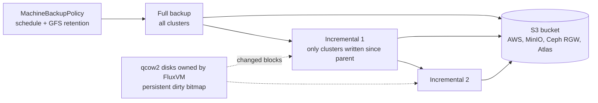

# User guide: incremental S3 backups (experimental)

A `MachineBackup` with `spec.target.s3` goes straight from FluxVM to an
S3-compatible bucket (AWS S3, MinIO, Ceph RGW, Atlas S3) and can be
**incremental**: FluxVM keeps a persistent dirty bitmap on every disk it
owns, so after one full backup each incremental uploads only the clusters
the guest wrote since its parent. A `MachineBackupPolicy` runs them on a
schedule with grandfather-father-son retention.

This is **experimental** until the lab rows in
[`COMPATIBILITY.md`](../COMPATIBILITY.md#incremental-s3-backups) pass. The
plain on-node backup in [machine-backup.md](machine-backup.md) is unchanged.




## What it needs

| Requirement | Why |
|---|---|
| The Machine boots from `spec.image` | Dirty bitmaps live in FluxVM's qcow2 disks. Machines booting from `spec.volumes` (PVC or Atlas) are refused; use `MachineSnapshot` or Atlas backups for those. |
| QEMU 5.1+ on the node | `bitmap-mode` and zstd qcow2 compression. kairon-node labels nodes whose FluxVM reports incremental S3 backups `kairon.zyvor.dev/cbt=true`; kairon-controller refuses S3 backups of Machines on other nodes. |
| Secrets labelled `kairon.zyvor.dev/backup-credentials=true` | kairon-node reads the credential and key Secrets a backup names, and refuses any Secret without the label. |
| `node.cbtBackup.enabled=true` (Helm) or `kubectl apply -f deploy/rbac-cbt-backup.yaml` | Grants kairon-node `get` on Secrets cluster-wide. Kubernetes RBAC cannot scope by label, so the label check above is enforced in kairon-node itself. Off by default. |

Root and data disks are both backed up, as one consistent set (one QMP
transaction). Disks FluxVM does not own (data disks linked to an external
block device or file, such as PVC-backed `spec.disks`) are skipped and named
in the backup's message.

## One-off backups

```bash
kubectl create secret generic s3-backup -n default \
  --from-literal=accessKeyId=... --from-literal=secretAccessKey=...
kubectl label secret s3-backup -n default kairon.zyvor.dev/backup-credentials=true

kaironctl backup create web --s3-endpoint http://minio:9000 --s3-bucket vm-backups --s3-credentials s3-backup
kaironctl backup create web --parent web-20260101-000000     # incremental; S3 settings come from the parent
kaironctl backup create web --mode synthetic-full --parent web-incr-7
kaironctl backup chain web
```

```yaml
apiVersion: kairon.zyvor.dev/v1
kind: MachineBackup
metadata:
  name: web-incr-1
spec:
  machineName: web
  mode: incremental          # full (default) | incremental | synthetic-full
  parent: web-full-1         # incremental: the backup it builds on
  target:
    s3:
      endpoint: http://minio:9000
      bucket: vm-backups
      prefix: kairon         # keys: kairon/<namespace>/<machine>/<chain>/<seq>-<id>/
      credentialsSecretRef: s3-backup
      # region: us-east-1
      # pathStyle: false     # bucket.endpoint/key instead of endpoint/bucket/key
  compression: zstd
  # encryption: {algorithm: aes256-gcm, keySecretRef: backup-key}
  # immutableFor: 30d        # S3 Object Lock retention
```

`status` records where the backup sits:

| Field | Meaning |
|---|---|
| `chain.id`, `chain.sequence` | The chain and the backup's place in it. A full starts a chain at 1. |
| `chain.parent`, `chain.base` | The backup an incremental builds on; the full (or synthetic full) the chain starts from. |
| `kind`, `pointInTime` | full, incremental or synthetic-full; the instant a restore returns to. |
| `manifestKey`, `objects` | The S3 keys written. |
| `storedBytes`, `changedBytes` | Bytes in the bucket (compressed, encrypted) and guest bytes the layer carries. |
| `retentionUntil` | Object Lock date; the backup cannot be deleted before it. |
| `disk.fullRequired` | Set on a failed incremental when FluxVM could not take it: the bitmap is missing, or was left inconsistent by an unclean stop (SIGKILL, host crash), or the disk is new. The next backup must be a full; a policy takes one automatically. |

Restores work from **any** chain point, onto any Machine on any
CBT-capable node, not just the node that took the backup:

```bash
kaironctl halt web && kaironctl backup restore web-incr-1
```

FluxVM downloads the chain's layers (checking each SHA-256), stacks them and
writes the result into the halted Machine's disks.

## Policies

```yaml
apiVersion: kairon.zyvor.dev/v1
kind: MachineBackupPolicy
metadata:
  name: web-hourly
spec:
  selector: {tier: web}
  incrementalEvery: 1h       # minimum 5m
  fullEvery: 168h            # default
  target:
    s3: {endpoint: http://minio:9000, bucket: vm-backups, credentialsSecretRef: s3-backup}
  retention: {hourly: 24, daily: 7, monthly: 3}
```

See [`examples/machinebackuppolicy.yaml`](../../examples/machinebackuppolicy.yaml)
for encryption and Object Lock. From the CLI:

```bash
kaironctl backuppolicy create web-hourly --selector tier=web --incremental-every 1h \
  --s3-endpoint http://minio:9000 --s3-bucket vm-backups --s3-credentials s3-backup --hourly 24 --daily 7
kaironctl backuppolicy describe web-hourly
kaironctl backuppolicy suspend web-hourly
```

For each selected Machine, kairon-controller:

- runs **one backup at a time**: nothing new starts while a backup or
  synthetic full is in flight;
- takes a **full** when there is no chain yet, when `fullEvery` has passed,
  when `mode: full`, or after a backup failed with `fullRequired`;
  otherwise an **incremental** on the newest successful backup;
- applies **GFS retention**: it keeps the newest point of each of the last
  `hourly` hours, `daily` days and `monthly` months (plus the newest point),
  and every backup those points need to restore;
- **consolidates** with a synthetic full when a kept point's chain still
  reaches back to a full that retention would otherwise drop: FluxVM reads the
  chain from S3 and writes one standalone layer at that point (`mode:
  synthetic-full`, `parent:` the point). Once it succeeds, the older backups
  are no longer needed and are deleted. Incrementals after the point keep
  working; restores read the synthetic full instead of the deleted layers;
- **never forces Object Lock**: a backup retention wants gone but still
  under `retentionUntil` stays, and is listed in
  `status.machines[].retentionHeld`.

`status.machines[]` also shows each Machine's chain, last full and
incremental, next run, and why it was skipped (`spec.volumes` boot, node
without the `kairon.zyvor.dev/cbt` label) or failed.

Deleting a policy leaves its backups. Deleting a backup deletes its S3
objects first (kairon-node, finalizer `kairon.zyvor.dev/cbt-backup`); under
Object Lock the delete waits for the retention date.

## Encryption and immutability

`encryption.keySecretRef` names a Secret whose `key` is 32 bytes (raw or
base64) and whose optional `keyId` names it in manifests (default: the
Secret name). FluxVM encrypts each layer with AES-256-GCM in 1 MiB frames
before upload and records the key id; a restore with a different `keyId` is
refused. Rotate by creating a new Secret and a new chain (a full).

`immutableFor` sets S3 Object Lock in COMPLIANCE mode on every object; the
bucket must have Object Lock enabled.

## Watching it

| Metric | |
|---|---|
| `kairon_backup_bytes_total{kind}` | Bytes stored by successful S3 backups. |
| `kairon_backup_duration_seconds{kind,result}` | Creation to completion. |
| `kairon_backup_chain_length{namespace,policy,machine}` | Successful fulls and incrementals in a policy Machine's current chain. |
| `kairon_backup_last_success_timestamp{namespace,policy,machine}` | Point in time of the newest successful backup. |

The dashboard's **Backups** page shows each Machine's chains with a Restore
button per point; **Backup policies** shows policies and per-Machine state.
The SDKs have `backups.create(..., mode=...)` and `backups.chain(machine)`;
the MCP `machine_backup` tool takes `mode`, `parent` and `policy`.

## Limits

- Experimental: not yet run through the lab matrix on real hardware.
- One FluxVM node writes each backup; there is no multi-node parallelism.
- Restores replace the target Machine's disks; there is no file-level restore.
- A FluxVM restart during a backup fails that job; the next one is a full if
  the bitmaps were not flushed cleanly.
